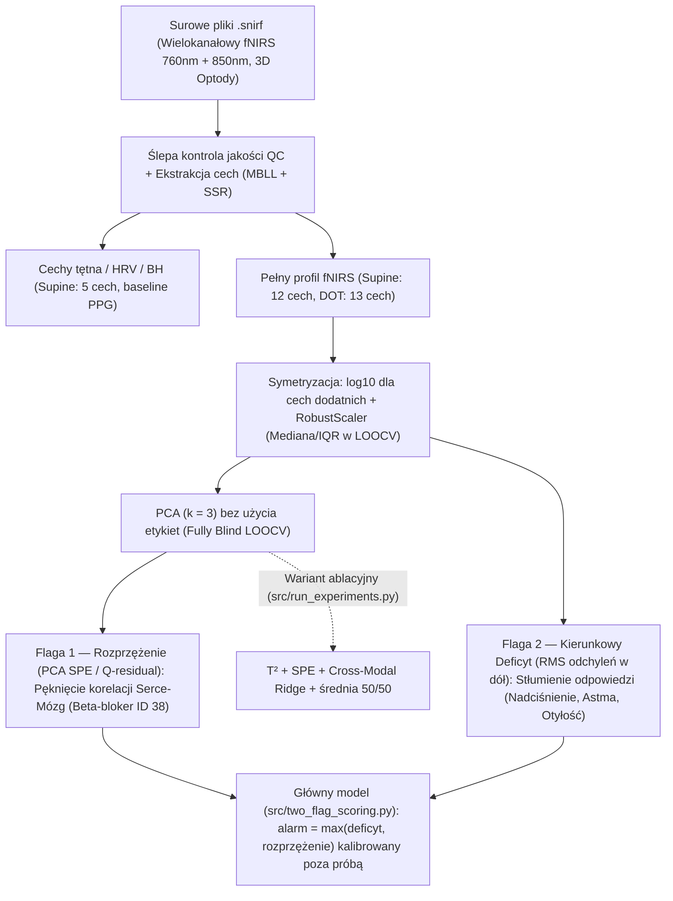

# Metodologia Nienadzorowanego Wykrywania Anomalii Fizjologicznych w Sygnałach fNIRS

**Projekt:** Heroes of the Brain 2026 — Ścieżka *Breath, Brain & Body* (Cortivision fNIRS)  
**Cel dokumentu:** Opis architektury, założeń fizycznych i matematycznych systemu nienadzorowanego wykrywania anomalii (*Normative Unsupervised Anomaly Detection*) trenowanego w schemacie Leave-One-Out (`LOOCV`) na kohorcie referencyjnej i walidowanego wyłącznie na obiektywnych etykietach klinicznych z ankiety.

---

## 1. Cel Podejścia i Problem Badawczy

W zastosowaniach medycznych i przesiewowych (*screening / triage*) rzadko dysponujemy dużymi, zbalansowanymi zbiorami danych dla każdej możliwej choroby, leku czy deficytu naczyniowego. Dysponujemy natomiast zapisami od **osób zdrowych (bez zadeklarowanych chorób przewlekłych i leków krążeniowo-oddechowych w `subjects_description.csv`)**, które definiują fizjologiczną normę populacyjną.

**Główny cel naszego podejścia:**
1. **Nauczyć model „fizjologii normatywnej” wyłącznie na kohorcie referencyjnej** (`One-Class / Normative Modeling`) bez użycia jakichkolwiek etykiet klinicznych czy danych ankietowych jako cech wejściowych ML.
2. **Wykrywać jako anomalie wyłącznie obiektywne przypadki kliniczne, farmakologiczne i metaboliczne zdefiniowane w `subjects_description.csv` (Zero Cyrkularności Cech):**
   * ukryte blokady farmakologiczne (przyjmowanie **beta-blokera** — `ID 38`, 29 lat, *Nebilet*),
   * schorzenia układu krążenia u seniorów (**nadciśnienie tętnicze** — `ID 48, 49, 59, 60`, wiek 68–78 lat, leki `"od nadcisnienia"`),
   * przewlekłe schorzenia oddechowe (**astma oskrzelowa** — `ID 12`, 21 lat, `Astma`, `Doraźnie na astmę`),
   * zaburzenia metaboliczne (**otyłość I stopnia wg kryterium WHO $\text{BMI} \ge 30.0\text{ kg/m}^2$** wyliczona z wagi i wzrostu w ankiecie: `ID 16` z $\text{BMI} = 30.9$ oraz `ID 9` z $\text{BMI} = 30.1$),
   * przy jednoczesnym prawidłowym klasyfikowaniu **negatywnych kontroli lekowych** (leki dermatologiczne na trądzik *Izotec* `ID 39, 43` oraz lek jelitowy *Cornax* `ID 17`) jako normy.
3. **Udowodnić unikalną wartość technologii fNIRS względem klasycznej fotopletyzmografii (PPG / smartwatcha / pulsoksymetru):** wykazać, że wielokanałowy, dwufalowy pomiar korowo-skórny fNIRS wykrywa anomalie naczyniowe i sprzężenia Serce $\rightarrow$ Mózg, na które sam pomiar obwodowego tętna i zmienności rytmu zatokowego (PPG) jest całkowicie ślepy, oraz eliminuje fałszywe alarmy (*False Positives*) generowane przez zdrowe osoby o silnym odruchu bezdechowym lub wysokim HRV.

---

## 2. Dlaczego Zwykły „Ślepy” Detektor Outlierów Zawodzi i Jak Go Naprawiliśmy?

Wstępne podejście oparte na wrzuceniu wszystkich uczestników do klasycznego algorytmu *Isolation Forest*, jednowymiarowego $\max(|Z|)$ lub oparciu się wyłącznie na obwodowym sygnale tętna (`Virtual PPG`) napotyka trzy fundamentalne problemy:

1. **Zanieczyszczenie rozkładu (*Contamination*):** Jeśli uczymy detektor na całej kohorcie jednocześnie, obecność seniorów z nadciśnieniem i osób na lekach kardiologicznych rozciąga estymowaną wariancję „normy”, maskując subtelniejsze anomalie.
2. **Pułapka Łagodnej Hiper-Reaktywności u Zdrowych (*Benign Hyper-Responder False Positives*):** W surowym sygnale fizjologicznym ogon rozkładu o najwyższej amplitudzie jest zdominowany przez całkowicie zdrowych młodych uczestników, którzy potrafią długo wstrzymać oddech (np. `ID 13` — $105.9\text{ s}$ mimo przeciętnej aktywności fizycznej w ankiecie `1,76`), mają wysokie spoczynkowe HRV (`ID 1, 16` — $\text{RMSSD} > 115\text{ ms}$) lub bardzo silny rezonans oddechowy $0.1\text{ Hz}$ (`ID 13` w kohorcie DOT — wzmocnienie $10.6\times$). Zwykły detektor bezkierunkowy (oraz samo `Virtual PPG`) generuje na tych zdrowych osobach fałszywe alarmy (`3 FP` w `Virtual PPG` w Supine na progu 90%, `ROC-AUC = 0.420`), podczas gdy osoby z patologicznym stłumieniem odpowiedzi naczyniowej giną w pobliżu mediany. Kierunkowa flaga deficytu eliminuje alarmy dla zdrowych osób o samym wysokim HRV/długim bezdechu (np. `ID 1` `alarm_pct = 38.3%`, `ID 16` `42.6%`), choć dwustronna flaga rozprzężenia (`PCA SPE`) nadal potrafi wyłapać skrajne fizjologicznie próby (np. `ID 13` ze skokiem tętna `+29.6 bpm` przy `105.9 s` bezdechu ma `decoupling_pct = 100.0%`). *(Uwaga metodologiczna: traktowanie takich zdrowych osób jako „trafień” w sztucznie utworzonej klasie „Super-Sportowców” na podstawie progu cech sygnałowych byłoby błędem cyrkularności — dlatego w naszej metodologii są oni rygorystycznie traktowani jako osoby zdrowe, a ich oflagowanie przez detektor kliniczny jest liczone jako False Positive).*
3. **Kompensacja obwodowa maskująca patologię w pojedynczych cechach:** Organizm pod wpływem leków (np. beta-blokera u `ID 38`) utrzymuje tętno spoczynkowe ($56.7\text{ bpm}$) i czas bezdechu w normie ($30.0\text{ s}$). Dopiero analiza **współzależności (korelacji) między pracą serca a głęboką hemodynamiką kory mózgowej** ujawnia pęknięcie fizjologicznego sprzężenia.

---

## 3. Jak Obsługujemy Wiele Czujników, Dwie Długości Fali i Geometrię 3D Optod?

Każde nagranie `.snirf` (biblioteka `h5py`) zawiera wielokanałowy zapis intensywności światła z wielu par źródło–detektor rozmieszczonych nad lewą i prawą półkulą kory przedczołowej. Zamiast uśredniać wszystkie kanały do jednego sygnału, wykorzystajmy pełną informację przestrzenną i spektralną:

### 3.0. Ślepa kontrola jakości kanałów krótkich i długich (QC *a priori*, Yücel i in., 2021)
Każde nagranie przechodzi automatyczne, całkowicie ślepe na etykiety sprawdzenie jakości kanałów w funkcji `compute_windowed_sci` (`SCI >= 0.70`, brak przesterowania detektora `p99 <= 4.90 V` i brak zaniku sygnału `p01 >= 0.005 V`):
* W Zbiorze 1 (`Supine`) z 60 zapisanych uczestników 2 ma niepełny protokół (`ID 41` brak `BS`, `ID 59` brak `BH`), a 10 zdrowych osób z grupy kontrolnej nie ma ani jednego ważnego kanału krótkiego `10 mm` (`ID 3–11`: nasycenie toru `850 nm` w okolicy `4.64–4.99 V` w obu sesjach; `ID 35`: zanik toru `760 nm` do `~0 V` w `BS`).
* Ponieważ regresja `SSR` na `od850` oraz separacja kora/skóra wymagają ważnego kanału krótkiego, osoby te są wykluczane z analizy przed modelowaniem zamiast cichego podstawiania nasyconych kanałów. Daje to czystą kohortę **`N = 48`** bez utraty ani jednego przypadku klinicznego z Kryterium A lub B.

### 3.1. Separacja głębokiej kory mózgowej od płytkiej skóry głowy (Short-Separation Regression — `SSR`)
Z macierzy `sourcePos3D` oraz `detectorPos3D` obliczamy trójwymiarową odległość euklidesową $d_{3\text{D}}$ dla każdego kanału pomiarowego:
* **Kanały płytkie (`Short-Separation`):** w Zbiorze 1 (`Supine`) dokładnie $d_{3\text{D}} = 10\text{ mm}$ (`dists < 15.0 mm`, pary `S7–D4` i `S8–D5`), a w Zbiorze 2 (`DOT Sitting`) $d_{3\text{D}} < 20\text{ mm}$ ($10\text{–}19.3\text{ mm}$). Mierzą one ukrwienie skóry głowy (skalp) oraz ogólnoustrojową falę tętna.
* **Kanały głębokie (`Long-Separation`):** $d_{3\text{D}} \ge 22\text{ mm}$ w Zbiorze 1 (głęboka kora $\ge 28\text{ mm}$) oraz $d_{3\text{D}} \ge 25\text{ mm}$ (do $41.5\text{ mm}$) w Zbiorze 2. Mierzą sumę sygnału ze skóry głowy oraz głębokiej kory mózgowej.

Aby wydobyć **czysty sygnał korowy**, dla każdego głębokiego kanału i każdej długości fali dopasowujemy metodą najmniejszych kwadratów (OLS z wyrazem wolnym $\hat{\beta}_0$ po wycentrowaniu sygnałów) regresję względem sygnału z kanałów płytkich:
$$y_{\text{cortex}}(t) = y_{\text{deep}}(t) - \left(\hat{\beta}_0 + \hat{\beta}_1 \cdot y_{\text{shallow}}(t)\right)$$
Dzięki temu oddzielamy reaktywność naczyń mózgowych (`bh_ssr_cortical_od850`, `spb_ssr_gain_med`) od obwodowego ukrwienia skóry głowy.

### 3.2. Dwie długości fali świetlnej ($760\text{ nm}$ vs $850\text{ nm}$) i Prawo Beera-Lamberta (MBLL)
Urządzenie fNIRS rejestruje absorpcję światła w dwóch oknach spektralnych ($\lambda_1 = 760\text{ nm}$ oraz $\lambda_2 = 850\text{ nm}$). W funkcji od_to_hb_mbll rozwiązujemy układ równań zmodyfikowanego prawa Beera-Lamberta (MBLL) przy użyciu macierzy molowych współczynników ekstyncji $\mathbf{E}$, eliminując *spectral cross-talk* i wyznaczając zmiany stężeń oksyhemoglobiny ($\Delta\text{HbO}$) oraz deoksyhemoglobiny ($\Delta\text{HbR}$):
$$\begin{bmatrix} \Delta\text{HbO}(t) \\ \Delta\text{HbR}(t) \end{bmatrix} = \frac{1}{d \cdot \text{PPF}} \mathbf{E}^{-1} \begin{bmatrix} \Delta\text{OD}_{760}(t) \\ \Delta\text{OD}_{850}(t) \end{bmatrix}$$
Stosunek amplitud $\Delta\text{HbR} / \Delta\text{HbO}$ oraz $\Delta\text{OD}_{760} / \Delta\text{OD}_{850}$ podczas bezdechu jest miarą równowagi między napływem tętniczym a utlenowaniem tkankowym — parametrem fizycznie niedostępnym dla jednofalowego czujnika PPG w zegarku, a ponadto odpornym na stały mnożnik ścieżki optycznej $\text{DPF}$.

### 3.3. Koherencja międzyhemisferyczna (Lewa vs Prawa półkula) i heterogeniczność przestrzenna
Na podstawie współrzędnej $X$ optod dzielimy kanały głębokie na lewą i prawą półkulę kory przedczołowej i wyznaczamy:
* **Koherencję naczyniową L–R (`bs_lr_mayer_corr`, `spb_lr_coherence`):** współczynnik korelacji Pearsona między wolnymi oscylacjami naczyniowymi lewej i prawej półkuli.
* **Przestrzenną zmienność odpowiedzi (`bh_spatial_cv`):** współczynnik zmienności odpowiedzi poszczególnych kanałów głębokich podczas bezdechu, wychwytujący lokalne asymetrie perfuzji.

---

## 4. Architektura Matematyczna: Jak Działa Nasza Detekcja Anomalii?

Zastosowaliśmy dwustopniową architekturę normatywną walidowaną w schemacie **Leave-One-Out Cross-Validation (LOOCV)**:

### 4.1. Transformacja symetryzująca i `RobustScaler`
Wiele cech fizjologicznych (np. wzmocnienie fal Mayera `spb1_gain_01hz`, `spb_ssr_gain_med`, zmienność `RMSSD`) ma silny rozkład prawostronnie skośny (log-normalny).
* Po transformacji logarytmicznej ($\log_{10}$ lub $\log(1 + x)$) odchylenia w górę i w dół stają się **symetryczne względem mediany**.
* Następnie uczymy `RobustScaler` (mediana i rozstęp międzykwartylowy $\text{IQR}$) wyłącznie na $N_{\text{ref}} - 1$ osobach z kohorty referencyjnej w bieżącym kroku LOOCV.

### 4.2. Dekompozycja Podprzestrzeni PCA: Odległość Hotellinga $T^2$ vs Błąd Rekonstrukcji $SPE$ ($Q$-residual)
Na zestandaryzowanej macierzy cech referencyjnych uczestników $\mathbf{Z}_{\text{ref}}$ uczymy model PCA zachowujący $k=3$ główne składowe ($\mathbf{P}_k$). Dla każdego testowanego uczestnika z wektorem cech $\mathbf{z}$ dokonujemy projekcji na zdrową podprzestrzeń i rekonstrukcji:
$$\hat{\mathbf{z}} = \mathbf{z} \mathbf{P}_k \mathbf{P}_k^T, \qquad \mathbf{e} = \mathbf{z} - \hat{\mathbf{z}}$$

Z tego rozkładu wynikają dwie komplementarne miary:

1. **Statystyka Hotellinga $T^2$ (Odległość *wewnątrz* podprzestrzeni zdrowych korelacji):**
   $$T^2 = \sum_{j=1}^{k} \frac{t_j^2}{\lambda_j}$$
   Mierzy, jak daleko od środka populacji leży badany **wzdłuż głównych osi zmienności**. Wysokie $T^2$ osiągają zarówno osoby z silnym stłumieniem rezonansu oddechowego (np. astma `ID 12`), jak i osoby zdrowe o ponadprzeciętnej rezerwie oddechowej/HRV (które w detektorze dwustronnym stanowią fałszywe alarmy).

2. **Błąd Rekonstrukcji PCA — $SPE$ (*Squared Prediction Error* / $Q$-residual, Odległość *poza* podprzestrzenią):**
   $$\text{SPE} = \|\mathbf{z} - \hat{\mathbf{z}}\|_2^2 = \sum_{i=1}^{d} \left(z_i - \hat{z}_i\right)^2$$
   Mierzy **pęknięcie normalnych korelacji fizjologicznych między czujnikami**. U badanego przyjmującego **beta-bloker (`ID 38`, 29 lat)** czas bezdechu i cechy pojedyncze mieszczą się w normie (`deficit_pct = 29.8%` w `N = 48`, `29.5%` w młodej kohorcie), lecz odpowiedź korowa i tętno są rozprzężone (`PCA SPE = 97.9%` w `N = 48`; `97.7%` i `Cross-Modal Ridge = 100.0%` w młodej kohorcie) — rekonstrukcja $\hat{\mathbf{z}}$ drastycznie rozjeżdża się z rzeczywistym pomiarem.

### 4.3. Etap 2: Niestrojony Kierunkowy Triage Kliniczny (`Dwie Flagi: max(deficyt, rozprzężenie)`)
Aby uniknąć *overfittingu* parametrów pod małą próbę walidacyjną, w Etapie 2 **nie stosujemy ręcznie strojonych wag ani bramkowania pod wybrane podgrupy**. Wykorzystujemy wyłącznie:
1. **Niestrojony wskaźnik deficytu *a-priori* (`deficit_pct`, oparty na `_supine_stage2_formulas` / `_dot_stage2_formulas`):** równomierna średnia kwadratowa (RMS) jednostronnych odchyleń w kierunku niewydolności fizjologicznej (w Supine: obniżone SDNN, stłumione fale Mayera i ich stosunek do oddychania, obniżona koherencja L–R, stłumiona reakcja tętna oraz rozprzężenie kora–HR; w formule deficytu DOT: stłumione wzmocnienie rezonansu 0.1 Hz w SPB i dobroć rezonansu $Q$-factor, bez terminu pora-dnia `bh_evening_morning_ratio`, który pozostaje w 13-cechowym profilu `DOT_FEATURE_COLS` dla `PCA SPE` — usunięcie go również z `DOT_FEATURE_COLS` daje w DOT `ROC-AUC = 0.893`, $p = 0.0212$, `TP = 2/3, FP = 1`).
2. **Główny wariant dwuflagowy (`src/two_flag_scoring.py` → `alarm_pct = max(deficit_pct, decoupling_pct)`):** zamiast uśredniania obu flag (które rozwadnia przypadki manifestujące się wyłącznie na jednej osi, np. `ID 38` z samym rozprzężeniem albo `ID 49` z samym deficytem), alarmem jest **wyższa z dwóch ocen** (`deficit_pct` oraz `decoupling_pct = fnirs_spe_pct`), ponownie skalibrowana na rozkładzie poza próbą w zagnieżdżonym LOOCV (`Fully Blind LOOCV`). Po ślepym QC kanałów krótkich (`N = 48`) osiągamy w Supine Kryt. A `ROC-AUC = 0.892` ($p = 0.0053$, `TP = 2/4, FP = 3` na progu 90 oraz `TP = 3/4, FP = 4` na progu 85), w Supine Kryt. B `ROC-AUC = 0.833` ($p = 0.0027$, `TP = 3/7, FP = 2` na progu 90) oraz w DOT Kryt. B `ROC-AUC = 0.952` ($p = 0.0097$, `TP = 2/3, FP = 1`).
3. **Wcześniejszy wariant bazowy ze średnią 50/50 (`src/run_experiments.py` → `score_normative_combined`):** niestrojona średnia 50/50 percentyla podprzestrzeni z Etapu 1 (`fnirs_subspace_pct`) i percentyla deficytu *a-priori*, zachowana w repozytorium do celów porównawczych i ablacyjnych (`ROC-AUC = 0.866` w Supine Kryt. A na `N = 48` i `0.869` w DOT Kryt. B).

---

## 5. Ograniczenia Metodologiczne i Uczciwa Interpretacja Wyników

* **Mała liczebność klas pozytywnych ($n_{\text{pos}}$):** W Zbiorze 1 Kryterium A obejmuje $n_{\text{pos}} = 4$ (`ID 38, 48, 49, 60`), a w Zbiorze 2 Kryterium A obejmuje pojedynczy przypadek astmy ($n_{\text{pos}} = 1$, `ID 12`, `ROC-AUC = 0.906`, $p = 0.1098$), zaś Kryterium B $n_{\text{pos}} = 3$. Z tego powodu metryki grupowe (szczególnie w DOT Kryt. A) mają charakter eksploracyjny.
* **Czynnik zakłócający wieku u seniorów (`ID 48, 49, 60`):** Wszystkie trzy osoby z lekami na nadciśnienie w pełnej kohorcie Supine mają 70–78 lat, przy braku zdrowych seniorów w grupie kontrolnej (sam wiek daje tu `ROC-AUC = 0.983`). Na podstawie samego zbioru Supine nie można oddzielić wpływu nadciśnienia od fizjologicznego starzenia. Niezależnym dowodem specyficzności pozostaje przypadek `ID 38` (29 lat, beta-bloker *Nebilet*), który w audycie wyłącznie młodej kohorty (`n_young = 45`, wiek $\le 42$) osiąga `decoupling_pct = 97.7%` (`alarm_pct = 95.5%`, 4. miejsce) przy normalnym wyniku `Virtual PPG` (`18.2%`).
* **Wpływ otyłości ($\text{BMI} \ge 30$) między zbiorami:** W Zbiorze 2 (DOT) dwie osoby z $\text{BMI} \ge 30$ (`ID 9, 16`) osiągają wysokie wyniki deficytu rezonansu SPB; w oczyszczonym Zbiorze 1 (`N = 48`) dodanie trzech młodych osób z $\text{BMI} \ge 30$ (`ID 2, 51, 55`) daje w Kryt. B `ROC-AUC = 0.833` ($p = 0.0027$, flaga rozprzężenia wyłapuje `ID 2` z `alarm_pct = 91.5%`, natomiast `ID 51` i `ID 55` pozostają poniżej progu).
* **Precyzja i próg przesiewowy:** W głównym wariancie dwuflagowym (`max`) na Supine Kryterium A (`N = 48`) model osiąga `ROC-AUC = 0.892` ($p = 0.0053$), na progu 90% daje `TP = 2/4, FP = 3` (`review_to_catch_all = 16`), a na progu przesiewowym 85% przechodzi `TP = 3/4, FP = 4` (`ID 48` z wynikiem `87.2%`). Pozostałe fałszywe alarmy odzwierciedlają naturalną zmienność spoczynkowego HRV i fal Mayera wśród zdrowych uczestników.
