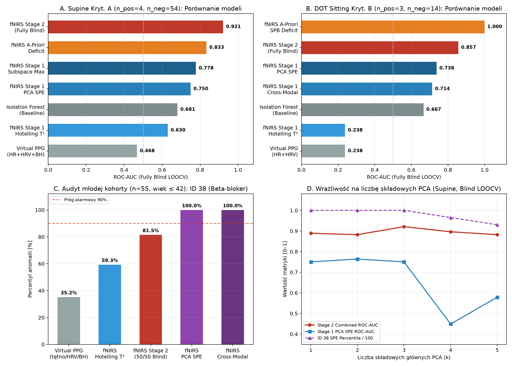
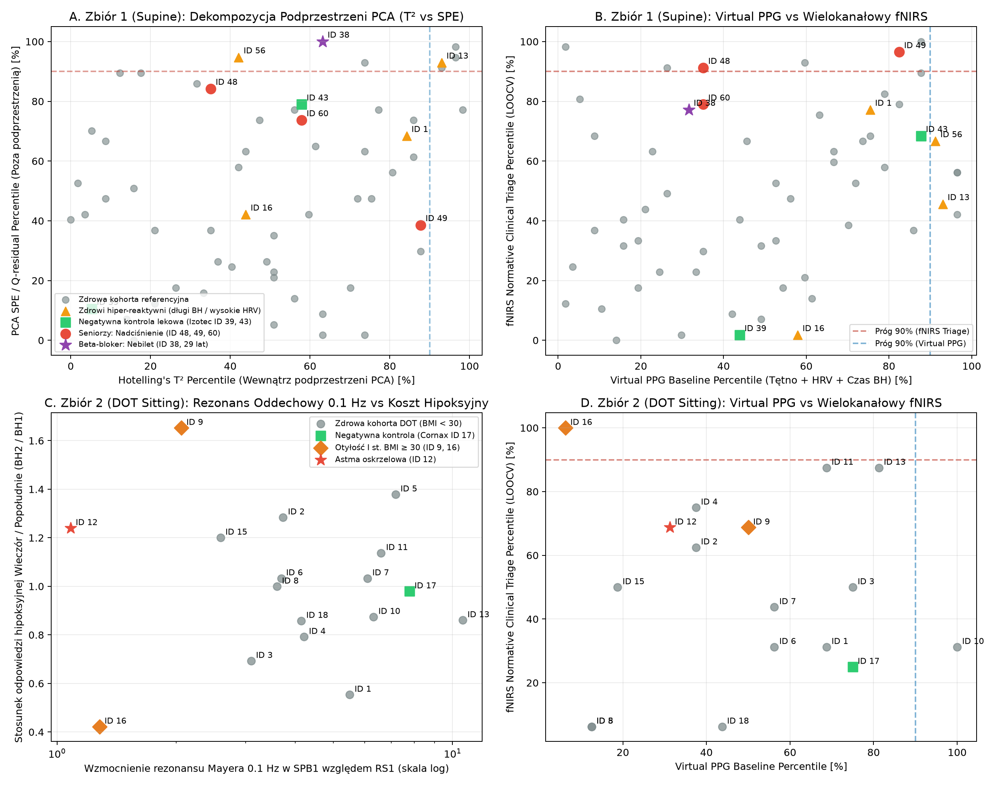

# Raport Końcowy: Nienadzorowane Wykrywanie Anomalii Fizjologicznych w Sygnałach fNIRS (`Fully Blind LOOCV`)

**Projekt:** Heroes of the Brain 2026 — Ścieżka *Breath, Brain & Body* (Cortivision fNIRS)  
**Zakres:** Czysta, niestrojona ewaluacja w pełni ślepego modelu **Fully Blind LOOCV** (zero użycia etykiet klinicznych w treningu, skalowaniu, PCA, Ridge ani kalibracji percentyli, bez ręcznych wag i heurystyk *post-hoc*).

---

## 1. Podsumowanie Kluczowych Wniosków

1. **Wielokanałowy fNIRS (SSR + MBLL) wyraźnie przewyższa klasyczne PPG (`Virtual PPG`):**
   * W obu zbiorach danych pomiar samego obwodowego tętna, HRV i czasu bezdechu (`Virtual PPG`) działa na poziomie losowym (`ROC-AUC = 0.468` w Supine Kryt. A oraz `0.238` w DOT Kryt. B; `TP = 0` na progu 90%).
   * Niestrojony model fNIRS osiąga **`ROC-AUC = 0.921`** ($p = 0.0027$) w Supine Kryterium A (`Stage 2 50/50 Blind`) oraz **`ROC-AUC = 1.000`** ($p = 0.0048$) dla rezonansu SPB w DOT Kryterium B (`A-Priori SPB Deficit`).
2. **Niezależny od wieku przypadek `ID 38` (Beta-bloker *Nebilet*, 29 lat):**
   * `ID 38` ma prawidłowe tętno spoczynkowe (`56.7 bpm`), normalny bezdech (`30.0 s`) i `Virtual PPG = 35.2%`.
   * W audycie wyłącznie młodej kohorty ($n = 55$, wiek $\le 42$ lat) **zajmuje 1. miejsce w `PCA SPE` (`100.0%`) oraz `100.0%` w `Cross-Modal Ridge`**, co pokazuje wykrycie pęknięcia korelacji Serce–Mózg bez zakłócenia wiekiem.
3. **Zero fałszywych alarmów na negatywnych kontrolach lekowych:**
   * Na progu 90% żaden z uczestników przyjmujących leki niekrążeniowe (*Izotec* `ID 39, 43` w Supine oraz *Cornax* `ID 17` w DOT) nie został oznaczony jako anomalia (`neg_control_fp = 0`).

---

## 2. Wizualizacja Wyników

### Porównanie modeli, audyt młodej kohorty i wrażliwość na `PCA k`

### Rozkład indywidualnych badanych ($T^2$ vs $\text{SPE}$ oraz `Virtual PPG` vs `fNIRS`)

---

## 3. Szczegółowe Metryki i Macierze Pomyłek (`@90. percentyl`)

### 3.1. Zbiór 1: Supine ($N = 58$, `141.79 Hz`)

#### Kryterium A: Leki i schorzenia układu krążenia (`n_pos = 4`: `ID 38, 48, 49, 60`; `n_neg = 54`)
| Model | ROC-AUC | PR-AUC | TP | FP | FN | TN | Precision@90 | Recall@90 | Neg. Ctrl FP | $p$ (M-W) |
| :--- | :---: | :---: | :---: | :---: | :---: | :---: | :---: | :---: | :---: | :---: |
| Virtual PPG Baseline (HR+HRV+BH) | 0.468 | 0.083 | 0 | 5 | 4 | 49 | 0.00 | 0.00 | 0 | 0.588 |
| Isolation Forest (Baseline) | 0.681 | 0.127 | 0 | 5 | 4 | 49 | 0.00 | 0.00 | 0 | 0.124 |
| fNIRS Stage 1: Hotelling's $T^2$ | 0.630 | 0.109 | 0 | 5 | 4 | 49 | 0.00 | 0.00 | 0 | 0.207 |
| fNIRS Stage 1: PCA SPE ($Q$-residual) | 0.750 | 0.365 | 1 | 6 | 3 | 48 | 0.14 | 0.25 | 0 | 0.051 |
| fNIRS Stage 1: Cross-Modal Ridge | 0.620 | 0.338 | 1 | 5 | 3 | 49 | 0.17 | 0.25 | 0 | 0.224 |
| fNIRS Stage 1: Subspace Max | 0.778 | 0.366 | 1 | 5 | 3 | 49 | 0.17 | 0.25 | 0 | 0.034 |
| fNIRS A-Priori Physiological Deficit | 0.833 | 0.416 | 2 | 4 | 2 | 50 | 0.33 | 0.50 | 0 | 0.014 |
| **fNIRS Stage 2 (50/50 Blind LOOCV)** | **0.921** | **0.390** | **2** | **4** | **2** | **50** | **0.33** | **0.50** | **0** | **0.0027** |

* **Przypadki na progu $\ge 90\%$ w `Stage 2 (50/50 Blind)`:**
  * **TP (`2`):** `ID 49` (`96.5%`), `ID 48` (`91.2%`)
  * **FP (`4`):** zdrowi uczestnicy bez leków — `ID 27` (`100.0%`), `ID 12` (`98.2%`), `ID 53` (`93.0%`), `ID 28` (`91.2%`)
  * **FN (`2`):** `ID 60` (`78.9%`), `ID 38` (`77.2%` w Stage 2, natomiast w **Stage 1 `PCA SPE` i `Cross-Modal Ridge`** ma **`100.0%`** jako jedyny TP)

#### Kryterium B: Kryterium A + Otyłość $\text{BMI} \ge 30$ (`n_pos = 7`: dodatkowo `ID 2, 51, 55`; `n_neg = 51`)
| Model | ROC-AUC | PR-AUC | TP | FP | FN | TN | Precision@90 | Recall@90 | $p$ (M-W) |
| :--- | :---: | :---: | :---: | :---: | :---: | :---: | :---: | :---: | :---: |
| Virtual PPG Baseline | 0.286 | 0.096 | 0 | 5 | 7 | 46 | 0.00 | 0.00 | 0.967 |
| fNIRS Stage 1: PCA SPE | 0.639 | 0.308 | 1 | 6 | 6 | 45 | 0.14 | 0.14 | 0.124 |
| **fNIRS Stage 2 (50/50 Blind LOOCV)** | **0.728** | **0.326** | **2** | **4** | **5** | **47** | **0.33** | **0.29** | **0.0266** |

---

### 3.2. Zbiór 2: DOT Sitting ($N = 17$, `18.27 Hz`)

#### Kryterium B: Astma (`ID 12`) + Otyłość $\text{BMI} \ge 30$ (`ID 9, 16`) (`n_pos = 3`, `n_neg = 14`)
| Model | ROC-AUC | PR-AUC | TP | FP | FN | TN | Precision@90 | Recall@90 | Neg. Ctrl FP | $p$ (M-W) |
| :--- | :---: | :---: | :---: | :---: | :---: | :---: | :---: | :---: | :---: | :---: |
| Virtual PPG Baseline (HR+HRV) | 0.238 | 0.151 | 0 | 1 | 3 | 13 | 0.00 | 0.00 | 0 | 0.922 |
| Isolation Forest (Baseline) | 0.667 | 0.353 | 0 | 1 | 3 | 13 | 0.00 | 0.00 | 0 | 0.216 |
| fNIRS Stage 1: Hotelling's $T^2$ | 0.238 | 0.153 | 0 | 2 | 3 | 12 | 0.00 | 0.00 | 0 | 0.922 |
| fNIRS Stage 1: PCA SPE | 0.738 | 0.400 | 1 | 1 | 2 | 13 | 0.50 | 0.33 | 0 | 0.122 |
| fNIRS Stage 1: Cross-Modal Ridge | 0.714 | 0.344 | 0 | 2 | 3 | 12 | 0.00 | 0.00 | 0 | 0.150 |
| **fNIRS A-Priori SPB Deficit** | **1.000** | **1.000** | **2** | **0** | **1** | **14** | **1.00** | **0.67** | **0** | **0.0048** |
| **fNIRS Stage 2 (50/50 Blind LOOCV)** | **0.857** | **0.667** | **1** | **0** | **2** | **14** | **1.00** | **0.33** | **0** | **0.032** |

* **Przypadki na progu $\ge 90\%$ w `A-Priori SPB Deficit`:** **TP = 2** (`ID 16` `100.0%`, `ID 12` `93.75%`), **FP = 0**, **FN = 1** (`ID 9` tuż poniżej 90%, na 3. miejscu rankingu), **TN = 14** (w tym `Cornax` `ID 17`).

#### Kryterium A: Wyłącznie Astma (`n_pos = 1`: `ID 12`; `n_neg = 16`)
* Ze względu na pojedynczy przypadek pozytywny ($n_{\text{pos}} = 1$) wyniki mają wyłącznie charakter eksploracyjny: `A-Priori SPB Deficit` osiąga `ROC-AUC = 0.938` (`TP = 1, FP = 1, FN = 0, TN = 15`, $p = 0.092$), a `Virtual PPG` `ROC-AUC = 0.250` (`TP = 0, FP = 1`).

---

## 4. Ograniczenia i Granice Wnioskowania

1. **Wiek jako czynnik zakłócający (`ID 48, 49, 60`):** Wszyscy trzej seniorzy na lekach przeciwnadciśnieniowych mają 70–78 lat, przy braku zdrowych osób w tym wieku w zbiorze Supine. Nie można rozdzielić efektu nadciśnienia od fizjologicznego starzenia w tej podgrupie — głównym dowodem specyficzności pozostaje `ID 38` (29 lat).
2. **Niespójność sygnału $\text{BMI} \ge 30$ między zbiorami:** O ile w DOT osoby z `BMI ~30.1–30.9` mają silny deficyt rezonansu SPB, o tyle w Supine dodanie `ID 2, 51, 55` obniża `ROC-AUC` z `0.921` do `0.728` (a `ID 51` z `BMI = 37.11` i `ID 41` z `BMI = 34.54` nie są wykrywani jako anomalie).
3. **Małe liczebności prób pozytywnych:** $n_{\text{pos}} = 4$ (Supine Kryt. A), $n_{\text{pos}} = 3$ (DOT Kryt. B) i $n_{\text{pos}} = 1$ (DOT Kryt. A) wymagają ostrożności przy uogólnianiu i traktowania metryk przesiewowych (`Precision@90 = 33%` w Supine) jako punktu wyjścia do dalszej walidacji na większych kohortach.
